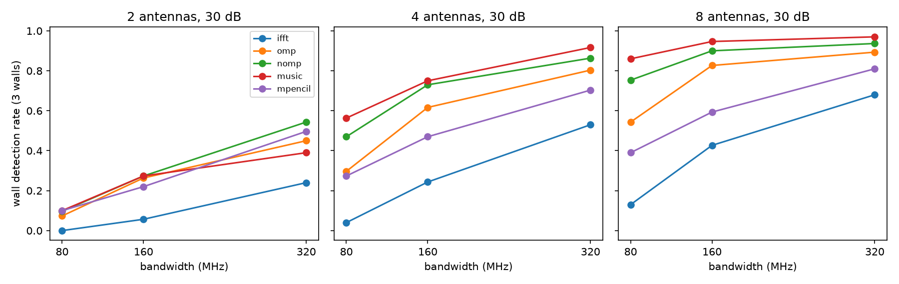

<div align="center">

<h1>wifi-wall-mapping</h1>

<p><strong>Simulation of how accurately one Wi-Fi AP finds room walls from CSI multipath.</strong></p>

</div>



Wall detection rate for one client position at 30 dB SNR (100 random positions per point). Antennas help as much as bandwidth: with MUSIC, 8 antennas at 80 MHz find more walls than 4 antennas at 160 MHz.

Watch 1 AP map an apartment while a person walks through every room. The page shows the walls, the rooms and the signal map: [dev.zyx.tw/wall-mapping](https://dev.zyx.tw/wall-mapping).

A home AP sees each wall as an echo of the client. This repo measures how close to the true wall position the AP gets, as a function of bandwidth, antenna count, estimator and hardware error.

## Features

- **Synthesize CSI**: 802.11 tone grids for 80, 160 and 320 MHz at 6.425 GHz, with an exact wideband array response.
- **Compare 5 estimators**: IFFT, OMP, NOMP, joint angle and delay MUSIC, and Matrix Pencil.
- **Add hardware errors**: random packet phase, timing offset, antenna phase, AGC, 8-bit quantization and RF chain ripple.
- **Fuse client positions**: cluster candidate walls, test consistency and solve the unknown LoS length.
- **Close rooms**: cut the plane with the wall lines, then merge the cells that the walk connects.
- **Model wall materials**: reflection and transmission of layered walls from ITU-R P.2040.
- **Fit wall loss**: the direct-path amplitude gives the loss of each found wall and a radio map.
- **Track the phone**: an EKF fuses phone dead reckoning with the AP's direct-path angle and FTM range.

## Results

The reference setup is 160 MHz, 4 antennas and 30 dB.

| Stage | Question | Result |
|-------|----------|--------|
| 1 | Is the geometry exact? | Yes. Wall error with true path parameters is below 1e-14 m. |
| 1 | How exact must the path parameters be? | Median wall error stays at or below 0.3 m for length noise up to 0.5 m. |
| 2 | Which estimator, one client position? | MUSIC: median 0.04 m, p90 0.15 m, 75% of walls found. IFFT finds 24%. |
| 3 | Which hardware error hurts? | Antenna phase most. Without calibration, MUSIC finds 8% of walls instead of 71%. RF chain ripple lowers MUSIC to 52%. |
| 4 | Does fusion remove false walls? | Yes, with NOMP and known LoS length: 0.1 false walls per map at 100 positions. An unknown LoS length leaves 1.4. |
| 5 | Do the walls close into rooms? | Partly. On the held-out apartment, MUSIC at 160 MHz gives 3 of 5 rooms (mean IoU 0.40). The true walls give 5 of 5 (0.95). |
| 6 | Do real wall materials break it? | NOMP holds: 3 of 5 rooms, 5 of 7 walls. MUSIC takes a reflection as the direct path on 27% of links and drops to 1 room. |
| 7 | What does direct-path loss add? | The loss of each wall: 10 cm concrete fits 14.7 to 15.3 dB (true 15.6). With these losses the radio map error behind walls is 1.1 dB (median). |
| 8 | What if the phone position is unknown? | IMU plus angle plus FTM tracks the phone to 0.10 m (median) and keeps 2.3 of 5 rooms. FTM alone gives 0.23 m but jumpy positions, and the rooms fall apart. |

Stage 3 at the reference setup, median wall error (m) and detection rate:

| Impairment | NOMP | MUSIC |
|------------|------|-------|
| none | 0.07, 0.72 | 0.04, 0.71 |
| all, antenna phase calibrated to 5 degrees | 0.09, 0.66 | 0.08, 0.49 |
| all, antenna phase uncalibrated | 0.28, 0.18 | 0.25, 0.09 |

Random packet phase, AGC and timing offset have no effect. The estimators use delay and angle relative to the LoS path, and these errors are common to all paths.

Stage 4 in 2D with all calibrated hardware errors, NOMP, 12 random rooms. Cells: median wall error (m), detection rate, false walls per map:

| LoS length | Bandwidth | 1 position | 10 positions | 100 positions |
|------------|-----------|------------|--------------|---------------|
| known | 160 MHz | 0.12, 0.61, 10.4 | 0.07, 0.83, 3.1 | 0.03, 0.92, 0.1 |
| known | 320 MHz | 0.06, 0.83, 11.1 | 0.02, 0.97, 5.3 | 0.02, 0.97, 0.4 |
| FTM, 0.3 m noise | 320 MHz | 0.13, 0.83, 11.1 | 0.06, 0.97, 5.6 | 0.03, 0.97, 0.3 |
| unknown | 320 MHz | not solvable | 0.14, 0.86, 7.3 | 0.06, 0.92, 1.4 |

MUSIC loses walls when it fuses more positions (160 MHz: 0.42 at 1 position, 0.25 at 100). The cause is not known yet. Floor and ceiling bounces (2.5D) leave 1.7 false walls per map with NOMP at 320 MHz.

Stage 5 on apartment B (held out, 3 walks, known LoS length, ideal hardware). A room counts when its IoU with a found room is 0.5 or more:

| Walls from | Mean IoU | Rooms | Walls found | False walls |
|------------|----------|-------|-------------|-------------|
| walk only | 0.07 | 0 / 5 | none | none |
| true walls | 0.95 | 5 / 5 | 7 / 7 | 0 |
| MUSIC, 160 MHz | 0.40 | 3.0 / 5 | 5 / 7 | 1.0 |
| NOMP, 160 MHz | 0.41 | 3.0 / 5 | 5 / 7 | 1.0 |
| NOMP, 320 MHz | 0.51 | 3.7 / 5 | 5 / 7 | 10.3 |

The AP sees few reflections from walls between 2 far rooms. Here those walls are the bedroom and bathroom wall and the kitchen and bedroom wall, so each pair of rooms becomes 1 room. A false wall near the AP splits the living room.

Stages 6 and 7 use walls from ITU-R P.2040. Plan `B` has 15 cm concrete outside and 12 cm brick and drywall inside. Plan `B-rc` has 10 cm concrete in place of the brick. The noise floor stays the same for every link, so walls lower the SNR. Radio map error in the rooms behind walls, NOMP at 160 MHz, median and p90 (dB):

| Prediction | B | B-rc |
|------------|---|------|
| free space | 1.7, 4.5 | 2.4, 10.8 |
| true walls, 5 dB each (TGax) | 2.0, 5.2 | 3.1, 6.8 |
| found walls, 5 dB each | 2.8, 7.1 | 2.5, 7.1 |
| found walls, fitted loss | 1.1, 4.7 | 1.7, 5.4 |

The fit reads the direct path at the known LoS length. The power rule of `relative_params` takes a reflection when a wall weakens the direct path, and then the concrete fits only 7 dB. Drywall fits 3.6 to 5.7 dB against 1.8 dB at normal incidence: most links cross it at a steep angle. The loss test removes the false wall near the AP, but the room count stays the same.

Stage 8 on plan B, NOMP at 160 MHz, phone IMU (4% step scale, 3 degrees of heading noise per step). The start heading is unknown except for `pdr`, which starts from the true pose:

| Positions from | Position error p50, p90 (m) | Walls found | False walls | Rooms |
|----------------|-----------------------------|-------------|-------------|-------|
| truth | 0, 0 | 5.0 / 7 | 4.3 | 3.0 / 5 |
| FTM only | 0.23, 0.54 | 4.0 / 7 | 2.3 | 0 / 5 |
| PDR only, known start | 0.15, 0.34 | 4.7 / 7 | 3.7 | 1.7 / 5 |
| IMU and angle | 0.40, 0.55 | 4.3 / 7 | 4.0 | 1.7 / 5 |
| IMU, angle and FTM | 0.10, 0.18 | 4.7 / 7 | 3.7 | 2.3 / 5 |

Without FTM, the IMU and the angle still find the LoS length to 0.38 m (median). The room step needs a smooth walk: noisy positions look like a person who walks through walls.

## Reproduce

```sh
uv sync
cd experiments
uv run python stage1.py
uv run python stage2.py 100
uv run python stage3.py 100
uv run python stage4.py 12
uv run python stage5.py
uv run python stage6.py
uv run python stage7.py
uv run python stage8.py
```

Each script writes JSON and PNG files to `results/<stage>/`. `demo_walk.py` writes the walk that the web demo in `demo/` plays. On 8 CPU cores, stage 2 takes 29 minutes and stage 3 takes 15 minutes. Stage 4 takes 28 minutes, stage 5 takes 7 minutes and stage 6 takes 15 minutes. Stages 7 and 8 reuse the links of stage 6.

## How it works


The model is 2D. The AP is on one wall with a linear array, so it measures only the cosine of the angle. Wi-Fi gives delay relative to the LoS path, so the LoS length must be known, measured by FTM or solved by fusion. Floor and ceiling bounces are optional interference (2.5D).

## For AI agents

Facts for coding agents and LLM tools. The rules for changing the code are in [AGENTS.md](AGENTS.md).

- **Summary**: Monte Carlo simulation of wall localization from Wi-Fi CSI multipath with one AP.
- **Type**: research
- **Interfaces**: none
- **Install**: `uv sync`
- **Run**: `cd experiments && uv run python stage2.py 100`
- **Verify**: `uv run pytest -q`
- **Config**: none
- **Secrets**: none
- **Limits**: 2D only, rectangular rooms in stages 1 to 4. No ray tracing or diffuse scattering yet. No hardware measurements yet.

## Development

```sh
git clone https://github.com/zyx1121/wifi-wall-mapping && cd wifi-wall-mapping
uv sync
uv run pytest -q
```

CI runs the alint grep rules on pull requests.
